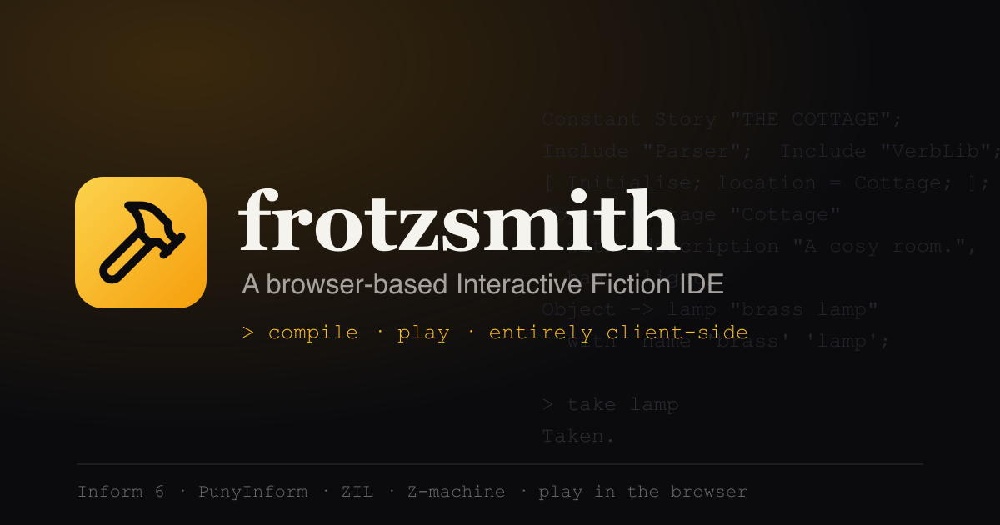

# frotzsmith

[](https://frotzsmith.frotzinc.com)

> A personal, browser-based **Interactive Fiction** IDE — write source, compile to a Z-machine story file entirely client-side, play it inline, and run long test scripts. **Two source languages: Inform 6 (+ PunyInform), and ZIL (via ZILF).** No accounts, no database — your source and story files never leave the browser (the only network traffic after load is cookieless, first-party Plausible pageview analytics, and a report if you choose to send one from the About menu).

[](./LICENSE)
[](https://nuxt.com)
[](https://www.typescriptlang.org)
[](https://github.com/DavidKinder/Inform6)
[](https://www.w3.org/WAI/WCAG21/quickref/)
[](./docs/00-master-design.md)
[](https://github.com/cschweda/frotzsmith/actions/workflows/ci.yml)
[](https://app.netlify.com/projects/frotzsmith/deploys)

> **Status — Inform 6 beta · ZIL alpha.** Write **Inform 6** (at `/`) or **ZIL** (at `/zil/`) and compile to a Z-machine story file entirely in the browser — I6 via `inform6.wasm` (Standard Library or PunyInform, auto-detected), ZIL via the **ZILF** compiler built to .NET WebAssembly. Then **play it inline** in frotzplay (or Parchment + the pure-JS ZVM, as a choice), watch a **live auto-map** draw as you explore, **capture your playthrough and replay command scripts headlessly**, load worked samples (21 for Inform 6, 7 for ZIL), and pull in your own extensions. A title-strip toggle flips between the two languages, each with its own namespaced project state. See [ROADMAP.md](./ROADMAP.md) for what's next and [CHANGELOG.md](./CHANGELOG.md) for what's shipped; design docs live in [`docs/`](./docs).

## What it is

frotzsmith mirrors the working rhythm of the classic Inform 7 IDE — source on the left, compile, watch results appear on the right where a successful build becomes a live, playable game — but for **Inform 6**, not Inform 7. It compiles entirely in the browser (the `inform6` compiler built to WebAssembly), auto-imports the correct standard library so a plain `.inf` "just works," plays the compiled story inline in [frotzplay](https://frotzplay.frotzinc.com) (or [Parchment](https://github.com/curiousdannii/parchment), on the Play tab), and exports the raw story file (`.z3`–`.z8`), a **self-contained, offline-playable HTML file** (player + story in one document), or a **folder (.zip)** in frotzplay — `index.html`, the player and the story, ready for itch.io's HTML upload or any static host, and still playable from a double-click.

A second source language, **ZIL** — Infocom's original MDL/Lisp-like language — lives at `/zil/`. It compiles with the modern [**ZILF**](https://foss.heptapod.net/zilf/zilf/) toolchain (ZILF + ZAPF, C#/.NET) built to WebAssembly and run **in a Web Worker**, so the ~5 s compile no longer blocks the UI (with an automatic main-thread fallback if the worker can't boot), with `zillib` embedded and the `<VERSION>` directive targeting z3/z5/z8. Because ZIL emits the same Z-code, everything downstream — inline play, the auto-map, test scripts, the transcript — works for ZIL unchanged. The heavy .NET bundle downloads and **pre-warms in the background when the ZIL page opens** (so the first compile behaves like a warm one, ~5 s) — Inform 6 users never download it.

**It works offline.** After your first visit the whole app — both IDEs, the Inform 6 compiler, the player, the Technical page — is kept by a service worker, so frotzsmith opens, compiles Inform 6 and plays with no connection at all; your browser can also **install it as an app** (it has a web manifest and icons). ZIL joins in once its compiler has been downloaded online one time — opening `/zil/` or compiling there does it — after which ZIL compiles offline too. A new deploy never takes over on its own: frotzsmith says *"A new version of frotzsmith is ready"* and waits for you to press **Reload** (your unsaved edits are written first). **About** in the footer shows the version you're running (`v0.1.0`) and has **Check for updates**.

A power-user testing layer runs arbitrarily long command scripts (`n. examine rock. lift rock.`) through a headless replay engine and shows the per-turn transcript. Playing by hand also records every command you type into a read-only **Transcript**, and one click turns that captured playthrough into a reusable **Test Script** — the linear spine from which a full branching Skein with blessed-output regression diffing later grows.

Projects travel as `.frotzsmith` packages — an open format: [spec](docs/spec/frotzsmith-package.md).

## Why

Inform 6 is the author's favourite IF language, but browser tooling is fragmented: interpreters play *finished* story files, and the Inform 7 IDE is a desktop app tied to I7's natural-language layer. There is no clean, modern, browser-native place to **write I6, compile it, and immediately play it** with library auto-import and saved test scripts. frotzsmith fills that gap — primarily for the author's own use, secondarily as a shareable open-source tool.

[Borogove](https://borogove.app) is the nearest neighbour and is excellent; frotzsmith is narrower by design — Inform 6 and ZIL, profile-driven, fully static, account-free, with a closer Inform 7-IDE feel and a script→Skein testing spine.

## The loop

```
write I6  ──▶  compile (inform6.wasm, client-side)  ──▶  play inline (frotzplay)
   ▲                       │                                      │
   └─ clickable errors ────┘                                      ▼
      jump to the bad line                          Transcript — the commands you typed
                                                              │
                                          Copy to Test Script ─┘
                                                  │
                                                  ▼
                              Test Script  ──▶  replay headlessly  ──▶  transcript
```

## Tech stack

| Area | Choice |
|------|--------|
| Framework | Nuxt 4 (static, `ssr: false`) |
| UI | Nuxt UI 4 |
| Editor | CodeMirror 6 (Inform 6 + ZIL syntax modes) |
| Compilers | Inform 6: `inform6` → WebAssembly (Emscripten) **in a Web Worker** (main-thread fallback). ZIL: **ZILF + ZAPF** (C#/.NET 10) → .NET WebAssembly in a Web Worker (main-thread fallback), pre-warmed on `/zil/` |
| Interpreter | [frotzplay](https://frotzplay.frotzinc.com) (`@frotzinc/player`), the accessible Z-machine player, by default; Parchment / ZVM as a choice on the Play tab |
| Headless engine | pure-JS ZVM (ifvms) in a Web Worker, behind a `StoryEngine` seam |
| Language | TypeScript |
| State | Vue composables (no Pinia) |
| Testing | Vitest — pure logic in Node, composable/state suites in happy-dom; CI (GitHub Actions) runs test (incl. the ZIL sample goldens) + typecheck + generate + artifact checks + an **axe-core zero-violation gate** on every push to `staging` and `main` and every PR |
| Theme | Dark by default, accessible light/dark toggle |
| Accessibility | WCAG 2.1 AA, axe-core zero-violation gate, fully responsive |
| Package manager | Yarn 1.22 |
| Runtime | Node 22 |
| Offline | Workbox service worker via `@vite-pwa/nuxt` — app precached, ZILF cached on first use, updates only on the author's Reload; installable (web manifest) |
| Analytics | Plausible (privacy-friendly, cookieless) |
| Hosting | Netlify (static; publishes `dist`), plus one small function that emails a report you choose to send |

## Roadmap

**Shipped:** client-side compile for **two source languages** — **Inform 6** (Standard Library + PunyInform, auto-detected; z3/z4/z5/z8 targets) and **ZIL** *(alpha)* via ZILF (z3/z5/z8 through the `<VERSION>` directive); a title-strip **I6 ↔ ZIL toggle** with per-language namespaced project state; clickable errors, crash-recovery autosave, **inline play** (frotzplay, or Parchment + ZVM), **export** as one HTML file or a folder (.zip), a **live auto-map** drawn as you explore, named **test scripts** (persisted) replayed headlessly with a per-turn **transcript** — or sent into the live game with **Send to Play** — a read-only **Transcript** that captures the commands you type while playing (one-click **Copy to Test Script**), worked samples (21 Inform 6 · 7 ZIL), extensions (drop-in `.h`/`.zip` + a select/deselect picker), Prettify, Open / Save As, a Technical Details page, and privacy-friendly analytics.

**New:** **the Skein** *(v1)* — a branching command tree with **blessed-output regression diffing**: live play and imported test scripts grow the tree; bless a thread, and every compile re-runs blessed threads headlessly, flagging changes red with a blessed-vs-current diff (per-game IndexedDB persistence, `.skein` export).

**New:** **Solutions** — each game's walkthrough as text (every `> command` and the game's reply), hidden until you ask, recorded by playing (Record / Pause / Resume / Stop, live in the left pane as `solution.txt`), and carried in `.frotzsmith` projects.

**Planned:** an online extensions registry, Glulx, and multi-file projects.

See [ROADMAP.md](./ROADMAP.md) for detail, [CHANGELOG.md](./CHANGELOG.md) for what's shipped, and [`docs/13-v2-roadmap.md`](./docs/13-v2-roadmap.md) for v2 feasibility notes.

## Documentation

The complete design suite lives in [`docs/`](./docs):

- [`00-master-design.md`](./docs/00-master-design.md) — thesis, locked decisions, success criteria
- `01`–`05` — phase specs (compiler core → export bundles)
- [`06-security.md`](./docs/06-security.md) · [`07-llm-build-prompts.md`](./docs/07-llm-build-prompts.md) · [`08-differentiation.md`](./docs/08-differentiation.md)
- [`09-monorepo-website.md`](./docs/09-monorepo-website.md) · [`10-revision-gap-analysis.md`](./docs/10-revision-gap-analysis.md)
- [`11-architecture-decisions.md`](./docs/11-architecture-decisions.md) — the ADR log
- [`12-use-cases.md`](./docs/12-use-cases.md) — concrete author workflows

## Beta testing

Trying frotzsmith out? [`docs/beta-testing.md`](./docs/beta-testing.md) has the
known limitations and what's most useful to report. **About → Report a problem…**
sends a report by email, or opens it as a GitHub [issue](https://github.com/cschweda/frotzsmith/issues)
with what you wrote filled in.

## Development

> Prerequisites: **Node 22** (see `.nvmrc`) and **Yarn 1.22**.

```bash
yarn install
yarn dev        # local dev server
yarn test       # unit tests (Vitest — Node + happy-dom suites)
yarn typecheck  # nuxt typecheck (strict)
yarn generate   # static build (Netlify publishes dist)
yarn preview    # preview the static build
```

**Branches:** work goes on a branch and a pull request into **`staging`**, which Netlify deploys as a free branch deploy (`staging--frotzsmith.netlify.app`). `staging` → `main` is the production deploy, made deliberately and with a merge commit. A push that changes only `README.md`, `ROADMAP.md`, `docs/` or `.github/` doesn't build at all (`ignore` in `netlify.toml`).

**For contributors:** state lives in Vue composables (no Pinia) — each is a pure logic file (`*.ts`, unit-tested as a sibling `*.test.ts`) plus a thin `use*` wrapper. The headless test-script engine is a `StoryEngine` seam (`app/modules/inform6/engine/`) that drives the pure-JS ZVM inside a Web Worker (`replay.worker.ts`), kept entirely separate from interactive Play: frotzplay (`@frotzinc/player`) mounted in the page by default, or a same-origin Parchment iframe (`public/play/`) as a choice. Design decisions are logged as ADRs in [`docs/11-architecture-decisions.md`](./docs/11-architecture-decisions.md).

## Security

frotzsmith compiles and plays entirely client-side, with no accounts and no database: your source and story files never leave the browser. The one server-side piece is a small Netlify Function that emails a report **you choose to send** (About → Report a problem / Suggest a feature) to the maintainer; it is same-site only, rate-limited and capped per day ([`docs/06-security.md` §10](./docs/06-security.md)). To report a security problem privately, see [`SECURITY.md`](./SECURITY.md). The design-level threat model lives in [`docs/06-security.md`](./docs/06-security.md); periodic red/blue audits are logged under **Security audits** below.

## Security audits

Periodic adversarial (red-team) + defensive (blue-team) reviews of the client-side attack surface. The newest audit is shown in full; older ones are condensed below. **Every audit is kept in full** in [`docs/security-audits/`](./docs/security-audits/README.md).

### 2026-11-09 — Security and code review (0.2.0–0.2.6)

**Scope:** what shipped after the 2026-11-04 audit — the frotzplay player and its exports, the family header and About menu, the email report function (the app's first server-side code), the domain move — plus deployment headers, CI and the dependency tree.
**Method:** a read of the code and the installed `@frotzinc` packages, sink searches, `yarn audit`, and probes of the live headers and the report function (invalid bodies only; nothing was sent).
**Overall posture: strong.** No High finding; no XSS sink in the app's own code; frotzplay's interpreter runs no generated code. Every finding below is fixed in 0.2.7. Full record: [`docs/security-audits/2026-11-09-review.md`](./docs/security-audits/2026-11-09-review.md).

| Severity | Finding | Mitigation |
|----------|---------|-----------|
| **Medium** | **The report function could be scripted.** Its checks were either sent by the client (the elapsed time, the hidden field) or kept in one function instance's memory, and it took a cross-site `text/plain` post. The recipient is fixed, so the harm was a flooded inbox and a spent email quota. | **Fixed:** same-site `application/json` posts only, 5 posts a minute per address at Netlify's edge, and at most 100 reports a day (`netlify/lib/report-guard.mjs`). |
| **Medium** | **The security notes described an app with no server**, and Parchment as the only player. | **Fixed:** `docs/06-security.md` covers the report function (§10), frotzplay and its exports. |
| **Low** | A report's title could carry line breaks into the email subject; CI checked a ZILF bundle the app no longer loads (and that 11 MB bundle was still deployed); `robots.txt` and the sitemap named the old `netlify.app` address; `yarn audit` listed 165 advisories in build and test tooling (3 critical, in the test runner); the custom domain's HSTS lacked `includeSubDomains`, and there was no `Cross-Origin-Opener-Policy`; a share link could load a source large enough to fill the browser's storage. | **Fixed:** one-line titles; CI reads the bundle name from the config and the old bundle is gone; both files name frotzsmith.frotzinc.com; vitest 4 and refreshed transitive packages (9 advisories left, none in shipped code); both headers set and pinned by a test; shared sources are capped at 1,000,000 characters. |

**Residual:** the CSP still allows inline script and `eval` (Parchment's and the replay engine's ZVM are JITs; ZILF's loader uses `new Function`), and Parchment and the replay worker still share the IDE's origin. With frotzplay the default, retiring the JIT interpreters is the way to tighten both.

<details>
<summary><strong>Older audits</strong> (condensed — full records in <code>docs/security-audits/</code>)</summary>

- **2026-11-04 — Red/blue audit (`.frotzsmith` package).** 2 High, 3 Medium, 12 Low, 1 Info; all fixed except the Info item (deferred). The Highs: JavaScript injection through the Z-machine JIT (both ZVM copies patched, and outside sources never auto-run), and a package replacing a library file for every later game (refused; the library always wins). The interpreters still share the IDE's origin. [Full record →](./docs/security-audits/2026-11-04-red-blue-audit.md)
- **2026-06-30 — Red/blue audit (play-transcript release).** 1 High, 3 Medium, 2 Low. These were fixed at the time: the remote-story delivery High (play page limited to same-origin `blob:`), the zip bomb, compiling on the main thread, the `postMessage` source pin, and part of the header hardening. The JIT-injection High and the analytics integrity item were closed by the 2026-11-04 audit. [Full record →](./docs/security-audits/2026-06-30-red-blue-audit.md)

</details>

## License & attribution

frotzsmith is licensed under the [GNU General Public License v3.0](./LICENSE) — © 2026 Christopher Schweda. It is GPLv3 because the ZIL backend bundles the GPLv3 [ZILF](https://foss.heptapod.net/zilf/zilf/) compiler and its `zillib` standard library; distributing them as part of this app requires the combined work to be GPLv3.

Bundled third-party components keep their own licenses:

- **Inform 6 compiler** and **Standard Library 6.12.8** — Artistic License 2.0 ([DavidKinder/Inform6](https://github.com/DavidKinder/Inform6))
- **PunyInform 6.7** — see [johanberntsson/PunyInform](https://github.com/johanberntsson/PunyInform)
- **ZILF + ZAPF compiler** and the **`zillib`** standard library — **GPLv3** ([zilf/zilf](https://foss.heptapod.net/zilf/zilf/), pinned at rev `5262550`), built offline to WebAssembly on the **.NET runtime** (MIT, [.NET Foundation](https://github.com/dotnet/runtime))
- **frotzplay** (`@frotzinc/player`, `@frotzinc/zmachine`) — MIT ([cschweda/frotzlens](https://github.com/cschweda/frotzlens/tree/main/apps/play)), the frotz, Inc. family's accessible player
- **Parchment** / **ZVM (ifvms)** — MIT ([curiousdannii/parchment](https://github.com/curiousdannii/parchment))

**Inspiration:** [Borogove](https://borogove.app) — the multi-language, browser-based IF IDE that proved this could be done well in the browser. **No Borogove code is used here**; frotzsmith is an independent take (Inform 6 and ZIL), but Borogove was a definite inspiration (and the model for the extension picker).

The **Haunted House** sample is reverse-engineered from Radio Shack's 1979 TRS-80 (Tandy Model I/III) text adventure and reimplemented in Inform 6.

A personal, weekend project — unaffiliated with any employer or organization. frotzsmith is part of [frotz, Inc.](https://frotzinc.com), the home of the frotz family of interactive-fiction tools, with its companion [frotzlens](https://frotzlens.frotzinc.com). frotz, Inc. is a fiction. The Frotz interpreter is the work of its own authors and is not affiliated.
